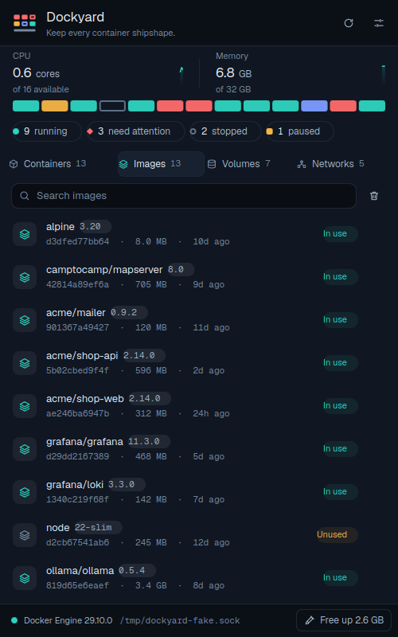
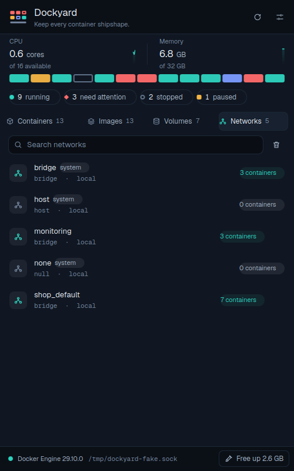
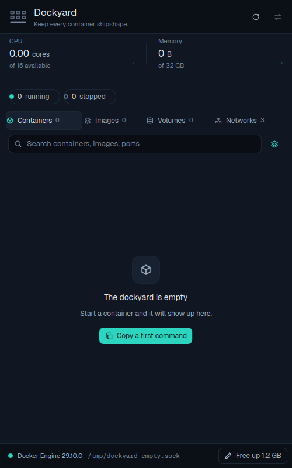

<p align="center"></p>

<h1 align="center">Dockyard</h1>
<p align="center"><b>Keep every container shipshape.</b><br>
A fast, good-looking Plasma 6 widget to watch and manage Docker and Podman, right from your panel.</p>

<p align="center">
  <a href="LICENSE"></a>
  
  
  <a href="README.vi.md"></a>
</p>

<p align="center"></p>

## Why Dockyard
- **See everything at a glance.** The *manifest strip* shows your whole fleet as one row of cells, one per container, coloured by state. Click a cell to jump straight to that container.
- **Know when something is wrong.** Unhealthy, restart-looping and crashed containers are called out, and you get a desktop notification.
- **Do the common things in one click.** Start, stop, restart, pause, logs, shell, open a port in the browser.
- **Native to Fedora KDE.** Follows your Plasma colour scheme and font size, works with Docker, rootless Docker and Podman, and needs nothing beyond Python (already on Fedora).

## Install
```bash
git clone https://github.com/phuonghx/dockyard
cd dockyard
./install.sh --restart      # per-user, no root. --restart reloads plasmashell
```
Then **right-click your panel → Add Widgets → Dockyard** and drag it in. To try it first in its own window:
`plasmawindowed io.dockyard.widget`.

> **"Can't reach Docker"?** Add yourself to the group and log out and in again:
> `sudo usermod -aG docker $USER`. For Podman: `systemctl --user enable --now podman.socket`.

## A quick tour

### Your fleet at a glance
CPU and memory for everything running (with history), the manifest strip, and one-click filters:
**running**, **need attention**, **stopped**, **paused**. Containers are grouped by Compose project; a project can be started,
stopped or restarted as a whole.

<p align="center"> &nbsp; </p>

Every state has its own **shape** as well as its colour, so it reads even without colour vision:

| | State | |
|---|---|---|
| ● filled circle | Running | |
| ◌ pulsing ring | Starting (health check running) | |
| ■ rounded square | Paused | |
| ◆ filled diamond | Unhealthy or restarting | needs attention |
| ◇ hollow diamond | Exited with an error | needs attention |
| ○ hollow circle | Stopped cleanly | |

### Work on a container
Click a row to open it. You get live CPU, memory and network, image, Compose project, ports (click to open in the browser,
or copy the address for databases), networks, mounts and restart policy. From there:

| Button | What it does |
|---|---|
| **Logs** | Opens a live log page: errors in red, warnings in amber, stack traces dimmed. Choose 100 / 300 / 1000 lines, pause, copy. |
| **Shell** | Opens bash (or sh) inside the container in Konsole. |
| **Restart / Pause / Resume** | One click. |
| **Kill / Remove** | Ask twice: the button turns red and says *Remove for good?*. No modal dialogs. |

### Images, volumes and networks
Everything the engine knows about, with *In use* and *Unused* badges and an "unused only" filter. Removing something that
is still in use is refused by the engine and Dockyard tells you why.

<p align="center">  </p>

### Free up space
The footer button opens a panel that says **what each clean-up removes and how much it should free** before you confirm:
stopped containers, dangling images, all unused images, anonymous volumes, build cache. Named volumes are never touched here.

### Friendly when things go wrong
Plain language and the exact fix, instead of a stack trace.

<p align="center">   </p>

## Speaks your language
Dockyard follows your system language automatically. Included: **English, Tiếng Việt, Español, Français, Deutsch, Português (Brasil), Русский, 日本語, 简体中文**.
Machine-checked for completeness (every message is translated in every language), written to read naturally rather than word for word.

<p align="center"></p>

Want another language, or a better phrase? It takes one file and no code. See [Translating](CONTRIBUTING.md#translating).

## Settings
Right-click the widget → **Configure Dockyard**.

| Setting | Default | Notes |
|---|---|---|
| Engine socket | `auto` | Finds Docker, rootless Docker and Podman. Or a path like `/run/user/1000/podman/podman.sock`. |
| Refresh while open / in background | 4 s / 20 s | Background refresh is quiet and cheap. |
| Container CLI, terminal command | `docker`, `konsole -e` | Used for **Shell**. |
| Notifications | on | Crashes, failing health checks, restart loops. |
| Theme | follow Plasma | Or always dark / always light. |
| Open on | Containers | Which tab the popup opens on. |
| Group by Compose project | on | |
| Show running count next to the panel icon | off | Takes exactly the width of the number. |

**Keyboard:** `Ctrl+F` focuses search, `Esc` clears it, closes logs, or closes the clean-up panel. Everything is reachable with Tab.

## How it works
`package/contents/scripts/dockyard.py` (Python standard library only) talks to the Engine API over the unix socket and always
prints exactly one JSON document, errors included. The QML polls it and patches its lists in place, so your scroll position
and hover survive every refresh. Nothing is sent anywhere except to the local socket.

## Develop and contribute
```bash
python3 -I -m unittest discover -s tests            # backend tests against a fake engine
python3 tools/fake_engine.py /tmp/dockyard-fake.sock &
DOCKER_HOST=unix:///tmp/dockyard-fake.sock plasmawindowed io.dockyard.widget
tools/screenshots.sh                                # regenerate the images above
```
Read [CONTRIBUTING.md](CONTRIBUTING.md). Contributors agree to the [CLA](CLA.md) and follow the
[Code of Conduct](CODE_OF_CONDUCT.md). Security issues: [SECURITY.md](SECURITY.md). Changes: [CHANGELOG.md](CHANGELOG.md).

## Author
**Xuan-Phuong Hoang**

- GitHub: [@phuonghx](https://github.com/phuonghx)
- Email: phuonghx.me@gmail.com
- Facebook: [@phuonghx.me](https://facebook.com/phuonghx.me)
- WhatsApp: @phuonghx.me
- X: [@phuonghx_](https://x.com/phuonghx_)

Issues and ideas: https://github.com/phuonghx/dockyard/issues · [MIT License](LICENSE). Geist fonts © Vercel, SIL OFL 1.1.
