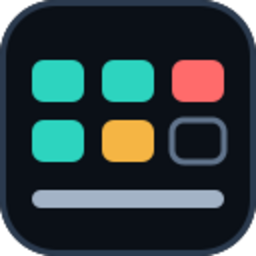

<p align="center"></p>

<h1 align="center">Dockyard</h1>
<p align="center"><b>Giữ mọi container luôn gọn gàng.</b><br>
Widget Plasma 6 đẹp và nhanh để theo dõi và quản lý Docker, Podman ngay trên panel.</p>

<p align="center"></p>

[English](README.md)

## Điểm nổi bật
- **Nhìn một lần là nắm hết:** dải *manifest* vẽ cả hệ thống thành một hàng ô, mỗi container một ô, đổi màu theo trạng thái. Bấm vào ô để nhảy tới container đó.
- **Biết ngay khi có sự cố:** container unhealthy, restart liên tục hoặc crash đều được báo, kèm thông báo trên desktop.
- **Thao tác nhanh:** start, stop, restart, pause, xem log, mở shell, mở cổng trong trình duyệt.
- **Hợp Fedora KDE:** theo giao diện sáng/tối và cỡ chữ của Plasma, hỗ trợ Docker, Docker rootless và Podman, chỉ cần Python (Fedora có sẵn).

## Cài đặt
```bash
git clone https://github.com/phuonghx/dockyard
cd dockyard
./install.sh --restart     # cài cho riêng bạn, không cần root
```
Sau đó **chuột phải panel → Add Widgets → Dockyard**. Muốn thử trước trong cửa sổ riêng: `plasmawindowed io.dockyard.widget`.

> **Báo "không truy cập được Docker"?** Thêm bạn vào nhóm docker rồi đăng xuất, đăng nhập lại:
> `sudo usermod -aG docker $USER`. Với Podman: `systemctl --user enable --now podman.socket`.

## Hướng dẫn nhanh
1. **Tổng quan:** CPU/RAM toàn hệ thống kèm biểu đồ, dải manifest và bộ lọc **running / need attention / stopped / paused**. Container được nhóm theo Compose project; có thể start/stop/restart cả project.
2. **Làm việc với một container:** bấm vào hàng để mở rộng, xem CPU/RAM/mạng, cổng, mount, rồi chọn **Logs** (log tô màu, lỗi đỏ, cảnh báo vàng), **Shell**, **Restart**, **Pause**, **Kill**, **Remove**. Thao tác nguy hiểm phải bấm hai lần.
3. **Images, Volumes, Networks:** có nhãn *In use* / *Unused* và bộ lọc "chỉ cái không dùng".
4. **Free up space:** nói rõ mỗi lần dọn xoá gì và giải phóng được bao nhiêu trước khi bạn xác nhận. Volume có tên không bị đụng tới.
5. **Khi có lỗi:** hiện câu chữ dễ hiểu và đúng lệnh để sửa, không phải stack trace.

Mỗi trạng thái có **hình dạng riêng** ngoài màu sắc (tròn đặc = chạy, vuông = tạm dừng, thoi = cần chú ý...), nên người khó phân biệt màu vẫn đọc được.

<p align="center"> </p>

## Cấu hình
Chuột phải widget → **Configure Dockyard**: socket, tần suất làm mới, terminal, thông báo, giao diện (theo Plasma / luôn tối / luôn sáng), tab mở đầu, nhóm theo Compose, hiện số container đang chạy cạnh icon.

Phím tắt: `Ctrl+F` tìm kiếm, `Esc` xoá tìm kiếm hoặc đóng log/panel dọn dẹp.

## Đóng góp
Xem [CONTRIBUTING.md](CONTRIBUTING.md). Người đóng góp đồng ý với [CLA](CLA.md) và tuân theo [Code of Conduct](CODE_OF_CONDUCT.md).

## Tác giả
**Xuan-Phuong Hoang** · [GitHub @phuonghx](https://github.com/phuonghx) · phuonghx.me@gmail.com · [Facebook](https://facebook.com/phuonghx.me) · [X @phuonghx_](https://x.com/phuonghx_) · WhatsApp @phuonghx.me

Giấy phép [MIT](LICENSE).
