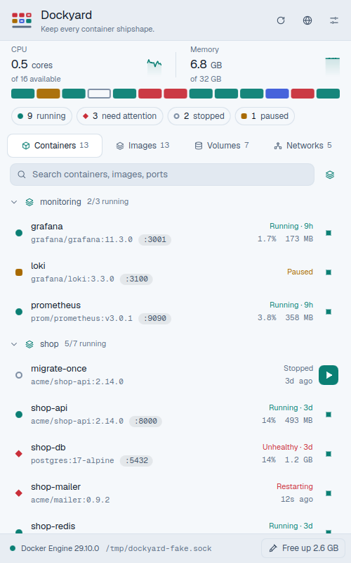

<p align="center"></p>

<p align="center">
<a href="../../README.md"></a>
<a href="README.vi.md"></a>
<a href="README.es.md"></a>
<a href="README.fr.md"></a>
<a href="README.de.md"></a>
<a href="README.pt-BR.md"></a>
<a href="README.ru.md"></a>
<a href="README.ja.md"></a>
<a href="README.zh-CN.md"></a>
</p>

<h1 align="center">Dockyard</h1>
<p align="center"><b>Gardez chaque conteneur en bon ordre.</b><br>Un widget <b>KDE Plasma 6 pour Docker et Podman</b>, rapide et soigné : surveillez et gérez conteneurs, images, volumes et journaux depuis votre panneau. Conçu pour Fedora KDE.</p>

<p align="center"><a href="https://phuonghx.github.io/dockyard/fr/"><b>Site web</b></a> · <a href="#installation">Installation</a> · <a href="../../CONTRIBUTING.md">Contribuer</a></p>

<p align="center">
<a href="https://store.kde.org/p/2382787/"></a>
<a href="https://www.opendesktop.org/p/2382787/"></a>
</p>

<p align="center"></p>

## Pourquoi Dockyard
- **Tout d’un coup d’œil :** la *bande de manifeste* dessine votre flotte comme une rangée de cellules, une par conteneur, colorées selon l’état. Cliquez sur une cellule pour aller à ce conteneur.
- **Sachez quand ça casse :** conteneurs en mauvaise santé, en boucle de redémarrage ou plantés sont signalés, avec une notification de bureau.
- **Le courant, en un clic :** démarrer, arrêter, redémarrer, mettre en pause, lire les journaux, ouvrir un shell, ouvrir un port dans le navigateur.
- **Natif sur Fedora KDE :** suit le jeu de couleurs et la taille de police de Plasma ; fonctionne avec Docker, Docker rootless et Podman ; seul Python est requis.

## Installation
```bash
git clone https://github.com/phuonghx/dockyard
cd dockyard
./install.sh --restart
```
Ensuite, **clic droit sur le panneau → Ajouter des composants graphiques → Dockyard**. Pour l’essayer d’abord : `plasmawindowed io.dockyard.widget`.

> **Docker est inaccessible ?** Ajoutez-vous au groupe puis reconnectez-vous : `sudo usermod -aG docker $USER`. Pour Podman : `systemctl --user enable --now podman.socket`.

## Visite rapide
1. **Vue d’ensemble :** CPU et mémoire de tout ce qui tourne, avec historique, la bande de manifeste et des filtres *en cours / à surveiller / arrêtés / en pause*. Les conteneurs sont groupés par projet Compose.
2. **Un conteneur :** cliquez sur sa ligne pour voir CPU, mémoire, réseau, ports et montages, puis **Journaux**, **Shell**, **Redémarrer**, **Pause**, **Arrêt forcé** ou **Supprimer**. Le destructif demande une double confirmation.
3. **Images, volumes et réseaux :** avec les badges *Utilisée* / *Inutilisée* et un filtre « inutilisés seulement ».
4. **Libérer de l’espace :** indique ce que chaque nettoyage supprime et l’espace gagné avant de confirmer. Les volumes nommés ne sont jamais touchés.
5. **En cas de problème :** des messages clairs avec la solution exacte, pas une trace d’erreur.

<p align="center"> </p>

## Langue
Choisissez la langue avec le bouton 🌐 du popup, ou laissez **Automatique** pour suivre le système. Disponible aussi dans *Configurer Dockyard*. Ajouter une langue ? Voir *Translating* dans [CONTRIBUTING](../../CONTRIBUTING.md#translating) : un seul fichier, sans programmer.

## Contribuer
Lisez [CONTRIBUTING.md](../../CONTRIBUTING.md). Les contributeurs acceptent le [CLA](../../CLA.md) et respectent le [Code de conduite](../../CODE_OF_CONDUCT.md). Licence [MIT](../../LICENSE).

## Auteur
**Xuan-Phuong Hoang** · [GitHub @phuonghx](https://github.com/phuonghx) · phuonghx.me@gmail.com · [Facebook](https://facebook.com/phuonghx.me) · [X @phuonghx_](https://x.com/phuonghx_) · WhatsApp @phuonghx.me
