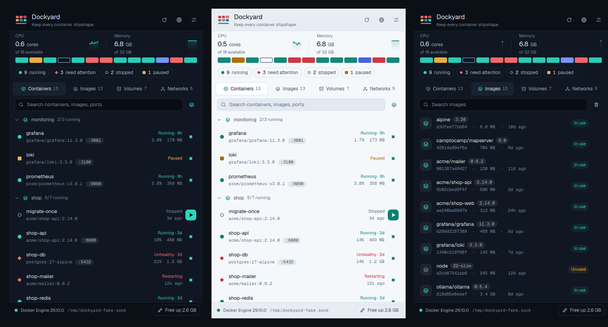

<p align="center"></p>

<p align="center">
<a href="../../README.md"></a>
<a href="README.vi.md"></a>
<a href="README.es.md"></a>
<a href="README.fr.md"></a>
<a href="README.de.md"></a>
<a href="README.pt-BR.md"></a>
<a href="README.ru.md"></a>
<a href="README.ja.md"></a>
<a href="README.zh-CN.md"></a>
</p>

<h1 align="center">Dockyard</h1>
<p align="center"><b>Mantenha cada contêiner em ordem.</b><br>Um widget <b>KDE Plasma 6 para Docker e Podman</b>, rápido e bonito: monitore e gerencie contêineres, imagens, volumes e logs direto do painel. Feito para o Fedora KDE.</p>

<p align="center"><a href="https://phuonghx.github.io/dockyard/pt-BR/"><b>Site</b></a> · <a href="#instalação">Instalação</a> · <a href="../../CONTRIBUTING.md">Contribuir</a></p>

<p align="center">
<a href="https://store.kde.org/p/2382787/"></a>
<a href="https://www.opendesktop.org/p/2382787/"></a>
</p>

<p align="center"></p>

## Por que o Dockyard
- **Tudo num relance:** a *faixa de manifesto* desenha toda a sua frota como uma fileira de células, uma por contêiner, coloridas pelo estado. Clique numa célula para ir até aquele contêiner.
- **Saiba quando algo quebra:** contêineres não saudáveis, em loop de reinício ou que caíram ganham destaque, com notificação na área de trabalho.
- **O dia a dia em um clique:** iniciar, parar, reiniciar, pausar, ler logs, abrir um shell, abrir uma porta no navegador.
- **Nativo no Fedora KDE:** segue o esquema de cores e o tamanho de fonte do Plasma; funciona com Docker, Docker rootless e Podman; só precisa de Python.

## Instalação
```bash
git clone https://github.com/phuonghx/dockyard
cd dockyard
./install.sh --restart
```
Depois, **clique direito no painel → Adicionar widgets → Dockyard**. Para testar antes: `plasmawindowed io.dockyard.widget`.

> **Sem acesso ao Docker?** Adicione-se ao grupo e faça login de novo: `sudo usermod -aG docker $USER`. Para Podman: `systemctl --user enable --now podman.socket`.

## Tour rápido
1. **Visão geral:** CPU e memória de tudo que está rodando, com histórico, a faixa de manifesto e filtros *em execução / precisam de atenção / parados / pausados*. Os contêineres são agrupados por projeto do Compose.
2. **Um contêiner:** clique na linha para ver CPU, memória, rede, portas e montagens, e use **Logs**, **Shell**, **Reiniciar**, **Pausar**, **Forçar parada** ou **Remover**. O que é destrutivo pede confirmação em duas etapas.
3. **Imagens, volumes e redes:** com selos *Em uso* / *Sem uso* e filtro de «só os sem uso».
4. **Liberar espaço:** mostra o que cada limpeza remove e quanto libera antes de você confirmar. Volumes nomeados nunca são tocados.
5. **Quando algo dá errado:** mensagens claras com a correção exata, não um despejo de erros.

<p align="center"> </p>

## Idioma
Escolha o idioma no botão 🌐 do popup, ou deixe **Automático** para seguir o do sistema. Também em *Configurar o Dockyard*. Quer adicionar outro? Veja *Translating* em [CONTRIBUTING](../../CONTRIBUTING.md#translating): basta um arquivo, sem programar.

## Contribuir
Leia o [CONTRIBUTING.md](../../CONTRIBUTING.md). Quem contribui concorda com o [CLA](../../CLA.md) e segue o [Código de Conduta](../../CODE_OF_CONDUCT.md). Licença [MIT](../../LICENSE).

## Autor
**Xuan-Phuong Hoang** · [GitHub @phuonghx](https://github.com/phuonghx) · phuonghx.me@gmail.com · [Facebook](https://facebook.com/phuonghx.me) · [X @phuonghx_](https://x.com/phuonghx_) · WhatsApp @phuonghx.me
