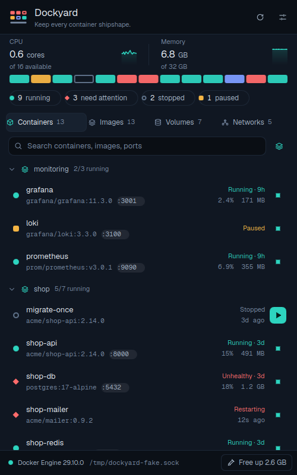

<p align="center"></p>

<p align="center">
<a href="../../README.md"></a>
<a href="README.vi.md"></a>
<a href="README.es.md"></a>
<a href="README.fr.md"></a>
<a href="README.de.md"></a>
<a href="README.pt-BR.md"></a>
<a href="README.ru.md"></a>
<a href="README.ja.md"></a>
<a href="README.zh-CN.md"></a>
</p>

<h1 align="center">Dockyard</h1>
<p align="center"><b>Giữ mọi container luôn gọn gàng.</b><br>Widget <b>KDE Plasma 6 cho Docker và Podman</b> đẹp và nhanh: theo dõi, quản lý container, image, volume và log ngay trên panel. Dành cho Fedora KDE.</p>

<p align="center"><a href="https://phuonghx.github.io/dockyard/vi/"><b>Trang web</b></a> · <a href="#cài đặt">Cài đặt</a> · <a href="../../CONTRIBUTING.md">Đóng góp</a></p>

<p align="center">
<a href="https://store.kde.org/p/2382787/"></a>
<a href="https://www.opendesktop.org/p/2382787/"></a>
</p>

<p align="center"></p>

## Điểm nổi bật
- **Nhìn một lần là nắm hết:** dải *manifest* vẽ cả hệ thống thành một hàng ô, mỗi container một ô, đổi màu theo trạng thái. Bấm vào ô để nhảy tới container đó.
- **Biết ngay khi có sự cố:** container unhealthy, khởi động lại liên tục hoặc crash đều được báo, kèm thông báo trên desktop.
- **Thao tác nhanh:** chạy, dừng, khởi động lại, tạm dừng, xem log, mở shell, mở cổng trong trình duyệt.
- **Hợp Fedora KDE:** theo giao diện sáng/tối và cỡ chữ của Plasma; hỗ trợ Docker, Docker rootless và Podman; chỉ cần Python.

## Cài đặt
```bash
git clone https://github.com/phuonghx/dockyard
cd dockyard
./install.sh --restart
```
Sau đó **chuột phải panel → Add Widgets → Dockyard**. Muốn thử trước: `plasmawindowed io.dockyard.widget`.

> **Không kết nối được Docker?** Thêm bạn vào nhóm docker rồi đăng xuất, đăng nhập lại: `sudo usermod -aG docker $USER`. Với Podman: `systemctl --user enable --now podman.socket`.

## Hướng dẫn nhanh
1. **Tổng quan:** CPU/RAM toàn hệ thống kèm biểu đồ, dải manifest và bộ lọc *running / need attention / stopped / paused*. Container được nhóm theo dự án Compose.
2. **Một container:** bấm vào hàng để xem CPU/RAM/mạng, cổng, mount, rồi chọn **Logs** (tô màu theo mức lỗi), **Shell**, **Restart**, **Pause**, **Kill**, **Remove**. Thao tác nguy hiểm phải bấm hai lần.
3. **Images, Volumes, Networks:** có nhãn *In use* / *Unused* và bộ lọc "chỉ cái không dùng".
4. **Free up space:** nói rõ mỗi lần dọn xoá gì và giải phóng được bao nhiêu trước khi bạn xác nhận. Volume có tên không bị đụng tới.
5. **Khi có lỗi:** câu chữ dễ hiểu và đúng lệnh để sửa, không phải stack trace.

<p align="center"> </p>

## Ngôn ngữ
Bấm nút 🌐 trên popup để chọn ngôn ngữ, hoặc để **Tự động** theo hệ thống. Cũng chọn được trong *Configure Dockyard*. Muốn thêm ngôn ngữ: mục *Translating* trong [CONTRIBUTING](../../CONTRIBUTING.md#translating), chỉ cần sửa một file, không cần biết lập trình.

## Đóng góp
Xem [CONTRIBUTING.md](../../CONTRIBUTING.md). Người đóng góp đồng ý với [CLA](../../CLA.md) và tuân theo [Code of Conduct](../../CODE_OF_CONDUCT.md). Giấy phép [MIT](../../LICENSE).

## Tác giả
**Xuan-Phuong Hoang** · [GitHub @phuonghx](https://github.com/phuonghx) · phuonghx.me@gmail.com · [Facebook](https://facebook.com/phuonghx.me) · [X @phuonghx_](https://x.com/phuonghx_) · WhatsApp @phuonghx.me
