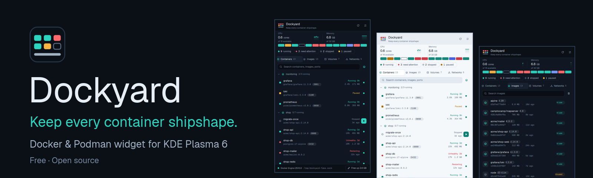

<p align="center"></p>

<p align="center">
<a href="../../README.md"></a>
<a href="README.vi.md"></a>
<a href="README.es.md"></a>
<a href="README.fr.md"></a>
<a href="README.de.md"></a>
<a href="README.pt-BR.md"></a>
<a href="README.ru.md"></a>
<a href="README.ja.md"></a>
<a href="README.zh-CN.md"></a>
</p>

<h1 align="center">Dockyard</h1>
<p align="center"><b>让每个容器井然有序。</b><br>一款快速、好看的<b>面向 Docker 和 Podman 的 KDE Plasma 6 小部件</b>：直接在面板上监控和管理容器、镜像、卷和日志。为 Fedora KDE 打造。</p>

<p align="center"><a href="https://phuonghx.github.io/dockyard/zh-CN/"><b>网站</b></a> · <a href="#安装">安装</a> · <a href="../../CONTRIBUTING.md">参与贡献</a></p>

<p align="center">
<a href="https://store.kde.org/p/2382787/"></a>
<a href="https://www.opendesktop.org/p/2382787/"></a>
</p>

<p align="center"></p>

## 为什么选择 Dockyard
- **一眼看清全局：** *清单条* 把整个容器集群画成一排格子，每个容器一格，颜色对应状态。点击格子即可跳到该容器。
- **出问题时马上知道：** 不健康、循环重启或崩溃的容器会被突出显示，并发送桌面通知。
- **常用操作一键完成：** 启动、停止、重启、暂停、查看日志、打开 Shell、在浏览器中打开端口。
- **原生适配 Fedora KDE：** 跟随 Plasma 的配色和字号；支持 Docker、rootless Docker 和 Podman；只需要 Python。

## 安装
```bash
git clone https://github.com/phuonghx/dockyard
cd dockyard
./install.sh --restart
```
然后 **右键点击面板 → 添加小部件 → Dockyard**。想先试用：`plasmawindowed io.dockyard.widget`。

> **连不上 Docker？** 把自己加入 docker 组，然后注销并重新登录：`sudo usermod -aG docker $USER`。Podman 用户：`systemctl --user enable --now podman.socket`。

## 快速导览
1. **总览：** 所有运行中容器的 CPU 和内存（带历史曲线）、清单条，以及 *运行中 / 需要关注 / 已停止 / 已暂停* 筛选。容器按 Compose 项目分组。
2. **单个容器：** 点击一行查看 CPU、内存、网络、端口和挂载，然后使用 **日志**、**Shell**、**重启**、**暂停**、**强制停止** 或 **删除**。破坏性操作需要两步确认。
3. **镜像、卷和网络：** 带有 *使用中* / *未使用* 标记，以及“仅显示未使用”筛选。
4. **释放空间：** 确认前先说明每项清理会删除什么、能释放多少。命名卷不会被触碰。
5. **出问题时：** 用清晰的语言和准确的解决方法提示，而不是一堆报错。

<p align="center"> </p>

## 语言
点击弹窗里的 🌐 按钮选择语言，或保持 **自动** 以跟随系统语言。也可在 *配置 Dockyard* 中设置。想增加语言？请见 [CONTRIBUTING](../../CONTRIBUTING.md#translating) 中的 *Translating*：只需一个文件，无需编程。

## 参与贡献
请阅读 [CONTRIBUTING.md](../../CONTRIBUTING.md)。贡献者需同意 [CLA](../../CLA.md) 并遵守 [行为准则](../../CODE_OF_CONDUCT.md)。许可证：[MIT](../../LICENSE)。

## 作者
**Xuan-Phuong Hoang** · [GitHub @phuonghx](https://github.com/phuonghx) · phuonghx.me@gmail.com · [Facebook](https://facebook.com/phuonghx.me) · [X @phuonghx_](https://x.com/phuonghx_) · WhatsApp @phuonghx.me
